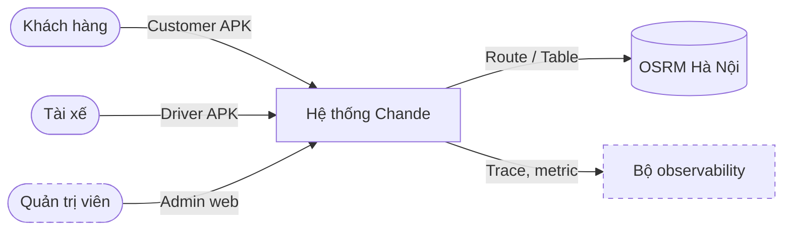
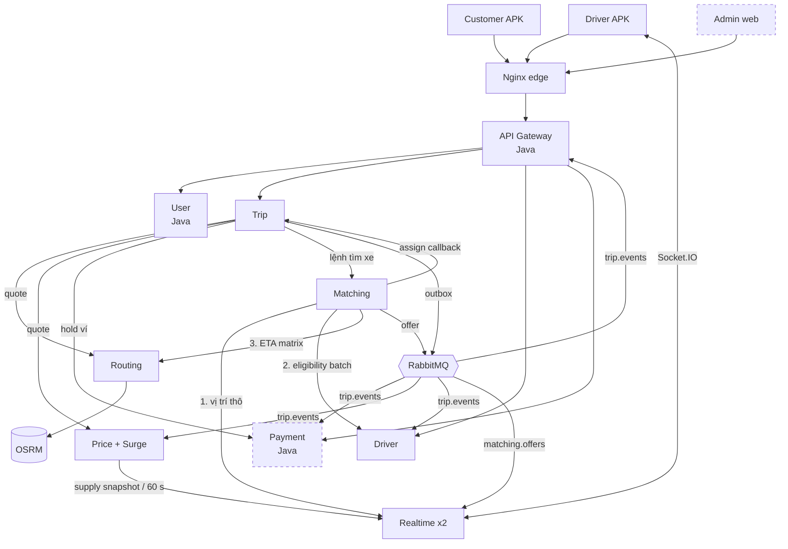

# Kiến trúc mục tiêu và lộ trình hai phase

| Thuộc tính | Giá trị |
| --- | --- |
| Service | Toàn hệ thống |
| Rà soát | 2026-10-27 |
| Quy ước | [Format và số liệu](quy-uoc-tai-lieu.md) |

Tài liệu đề xuất cải tiến kiến trúc Chande dựa trên các mẫu phổ biến của ứng dụng đặt xe lớn (Uber, Grab, Gojek, Be, Xanh SM), chia thành hai phase. Mỗi cải tiến ghi rõ **nằm ở đâu**, **phục vụ mục đích gì** và **khi nào coi là xong**. Quyết định lớn được tách thành [ADR](adr/README.md).

Trạng thái: **đề xuất**, chưa triển khai. Số liệu tài nguyên và hiệu năng trong tài liệu là ước tính, cần đo lại sau khi làm.

## 1. Bối cảnh và ràng buộc

| Ràng buộc | Giá trị đã chốt |
| --- | --- |
| Mục đích | Đồ án; hội đồng chấm nặng **kiến trúc microservice** và **chất lượng kỹ thuật** |
| Phase 1 | Hoàn thành phạm vi giai đoạn 1 (ERD giai đoạn 1) + củng cố kiến trúc |
| Phase 2 | Thanh toán (tiền mặt + ví nội bộ), đánh giá + Admin, giá động / khuyến mãi |
| Thời lượng | 2–3 tuần mỗi phase |
| Nhân lực | 3 người: 1 Java, 2 Node/TS. Phase 1: 1 người app + 2 người kiến trúc |
| Hạ tầng demo | Docker / Kubernetes local trên MacBook 16 GB RAM, 10 core |
| Công nghệ | Giữ Postgres, Redis, RabbitMQ; chỉ thêm bộ observability |
| Admin | Web React riêng, đi qua Gateway với role `ADMIN` |

## 2. Đối chiếu với ứng dụng đặt xe lớn

Cột "Mẫu tham chiếu" mô tả cách làm phổ biến được các công ty chia sẻ công khai, không phải mô tả chính xác hệ thống nội bộ của họ.

| Năng lực | Mẫu tham chiếu | Chande hiện tại | Đề xuất | Mã |
| --- | --- | --- | --- | --- |
| Điều phối tài xế | Dispatch service tự truy vấn chỉ mục vị trí, lọc, tính ETA, xếp hạng (Uber DISCO, Grab dispatch) | Matching gọi Routing, Routing gọi Realtime, Realtime gọi Driver, Driver gọi Trip + Matching | Matching tự tìm ứng viên, gọi thẳng 3 service, không vòng | P1.1 |
| Hết tài xế | Báo "không tìm thấy tài xế" sau vài phút | Chuyến ở SEARCHING vô hạn | Deadline tìm xe, huỷ với lý do `NO_DRIVER_FOUND` | P1.2 |
| Trục sự kiện | Kafka làm xương sống event, service mới tự subscribe | Outbox của Trip POST HTTP tới từng đích cố định | Outbox phát lên RabbitMQ topic exchange `trip.events` | P1.3 |
| Quan sát hệ thống | Distributed tracing (Jaeger ra đời ở Uber), metric tập trung, dashboard | Chỉ có `X-Request-Id` và log JSON | OpenTelemetry + Prometheus + Grafana + Jaeger | P1.4 |
| Thanh toán | Ví + sổ cái kép, giữ tiền (pre-authorization) trước chuyến, chốt khi hoàn thành | Chưa có | Payment service, sổ cái kép, Try-Confirm-Cancel | P2.1 |
| Giá | Giá chốt trước (upfront) + surge theo ô lục giác H3 (Uber) | Giá cố định theo km, đã khoá theo báo giá 5 phút | Hệ số surge theo ô H3 + mã khuyến mãi, vẫn khoá trong báo giá | P2.2 |
| Chất lượng dịch vụ | Đánh giá hai chiều, ảnh hưởng điều phối; duyệt tài xế | Chưa có | Đánh giá trong Trip, điểm trung bình ở Driver, trạng thái duyệt tài xế | P2.3 |
| Vận hành | Console nội bộ cho ops | Chưa có | Admin web React | P2.4 |
| Scale ngang | Nhiều replica, state ngoài process | 1 replica mọi service, Socket.IO không có adapter | Realtime 2 replica + Redis adapter, Matching worker cạnh tranh | P2.5 |

## 3. C1 — System Context đích



Thay đổi so với hiện tại: thêm actor **Quản trị viên** và hệ thống phụ **observability**. Không thêm phụ thuộc bên ngoài (ví nội bộ không gọi cổng thanh toán thật, OTP vẫn là mock).

## 4. C2 — Container đích



Nguyên tắc của sơ đồ đích:

- **Lệnh** (command) đi bằng HTTP đồng bộ và có chủ sở hữu rõ: Trip ra lệnh tìm xe, Matching ra lệnh assign.
- **Sự kiện** (event) đi qua RabbitMQ. Service mới (Payment, Price, Driver) chỉ cần bind queue, không phải sửa Trip.
- **Không còn vòng gọi đồng bộ.** Đồ thị gọi HTTP là cây có hướng: Gateway → Trip → {Routing, Price, Payment, Matching}; Matching → {Realtime, Driver, Routing}. Callback Matching → Trip là lệnh assign có idempotency, không nằm trong cùng request.
- Driver không còn gọi Trip / Matching để hỏi tài xế bận. Matching tự biết qua `matching_reservations`; phần còn lại (sửa xe, bật online) là phase sau (xem mục 9).

## 5. Danh mục cải tiến

Ưu tiên theo MoSCoW: **Must** bắt buộc cho demo, **Should** nên có, **Could** cắt được khi thiếu thời gian.

### Phase 1 — Hoàn thành giai đoạn 1 và củng cố kiến trúc

| Mã | Cải tiến | Nằm ở đâu | Mục đích | Ưu tiên | ADR |
| --- | --- | --- | --- | --- | --- |
| P1.1 | Matching tự tìm ứng viên, gỡ vòng gọi | Matching (`application/match.ts`, ports mới), Realtime (API vị trí thô), Driver (eligibility batch không occupancy), Routing (ETA matrix nhận origins) | Bỏ chuỗi 4 service trong một job, bỏ N+1 lời gọi Driver, mỗi service đúng một trách nhiệm | Must | [0001](adr/0001-matching-so-huu-tim-ung-vien.md) |
| P1.2 | Giới hạn thời gian tìm xe | Matching (deadline `SEARCH_TIMEOUT_MS`), Trip (huỷ bởi `SYSTEM` với lý do `NO_DRIVER_FOUND`) | Chuyến không treo vô hạn; khách nhận thông báo rõ; giải phóng tài nguyên | Must | [0004](adr/0004-gioi-han-thoi-gian-tim-xe.md) |
| P1.3 | Trục sự kiện RabbitMQ | Trip (outbox publisher), RabbitMQ (exchange `trip.events`), Gateway (consumer thay endpoint HTTP) | Trip không cần biết ai nghe; mở đường cho Payment, Price, Driver ở phase 2 | Must | [0002](adr/0002-truc-su-kien-rabbitmq.md) |
| P1.4 | Observability | Mọi service (OpenTelemetry SDK / Java agent), `deploy/` (Collector, Prometheus, Grafana, Jaeger) | Lần theo một chuyến xuyên service; đo latency, lỗi, funnel matching; bằng chứng cho phần "chất lượng kỹ thuật" | Must | [0003](adr/0003-observability-opentelemetry.md) |
| P1.5 | Vệ sinh cấu hình và bảo mật | Gateway `application.yaml` (bỏ token mặc định), các service (fail-fast khi thiếu secret), root repo (xoá thư mục rác chưa track) | Không lộ secret mặc định; tránh nhầm lẫn khi chấm | Should | — |
| P1.6 | Hoàn thành app giai đoạn 1 | `app/`: F07 native navigation, build 2 APK + e2e Android, F08 UI / lịch sử | Đủ luồng demo đầu–cuối trên Android | Must | — |

### Phase 2 — Thanh toán, đánh giá + Admin, giá động

| Mã | Cải tiến | Nằm ở đâu | Mục đích | Ưu tiên | ADR |
| --- | --- | --- | --- | --- | --- |
| P2.1 | Payment service | Service mới `service/payment-service` (Java 21), DB `payment`; Trip (chọn phương thức, gọi hold); Gateway (route ví) | Tiền mặt + ví nội bộ; sổ cái kép đảm bảo tiền không tự sinh/mất; hoa hồng nền tảng | Must | [0005](adr/0005-payment-so-cai-kep-tcc.md) |
| P2.2a | Giá động theo ô H3 | Price (component Surge, consumer `trip.events`, Redis), Realtime (API snapshot cung), Trip (gửi `pickup` sang Price) | Cân bằng cung cầu giờ cao điểm; minh hoạ tính toán dựa trên event | Must | [0006](adr/0006-gia-dong-theo-o-h3.md) |
| P2.2b | Mã khuyến mãi | Price (bảng promo, reserve / confirm / release theo event) | Tính năng thương mại phổ biến; tái dùng mẫu Try-Confirm-Cancel | Should | [0006](adr/0006-gia-dong-theo-o-h3.md) |
| P2.3 | Đánh giá + duyệt tài xế | Trip (bảng `trip_ratings`, event `trip.rated`), Driver (điểm trung bình, trạng thái duyệt), Matching (`rank()` dùng điểm) | Chất lượng dịch vụ ảnh hưởng điều phối; tài xế chưa duyệt không nhận chuyến | Must | — |
| P2.4 | Admin web | Ứng dụng mới `admin/` (Vite + React); Gateway (`/api/v1/admin/**`, role `ADMIN`); User (role `ADMIN`); endpoint admin ở Driver, Trip, Payment, Price | Duyệt tài xế, tra cứu chuyến / giao dịch, xem bản đồ surge | Must | [0007](adr/0007-admin-web-va-role-admin.md) |
| P2.5 | Scale ngang + chịu lỗi | Realtime (Socket.IO Redis adapter, 2 replica, chỉ transport websocket), Matching worker 2 replica (lease có sẵn), Gateway (rate limit trong Redis), client HTTP Node (circuit breaker) | Chứng minh hệ thống chạy nhiều replica và sống sót khi một pod chết | Should | — |
| P2.6 | Kiểm thử tải | `deploy/load/`: giả lập tài xế bằng Node + socket.io-client, k6 cho HTTP đặt xe | Số liệu p95, throughput thật để đưa vào báo cáo | Should | — |

## 6. Chi tiết cải tiến

### P1.1 — Matching tự tìm ứng viên

Luồng mới trong mỗi job tìm xe:

```text
1. Realtime  GET /internal/realtime/driver-locations   → ≤200 vị trí thô trong 2 km
2. Matching  (DB cục bộ) loại tài xế đã thử / đang có reservation
3. Driver    POST /internal/drivers/eligibility/candidates (lô 100) → eligible + snapshot
4. Matching  chọn top 25 theo khoảng cách đường chim bay
5. Routing   POST /internal/routes/eta-matrix (origins do Matching truyền)
6. Matching  rank() → tạo offer trong transaction (lock + reservation như cũ)
```

Triển khai theo 3 PR: thêm API mới → chuyển Matching → xoá đường cũ. Chi tiết PR, file và tiêu chí xong nằm trong [ADR 0001](adr/0001-matching-so-huu-tim-ung-vien.md).

**Xong khi:** Routing không còn biến `REALTIME_*`; Realtime không còn `DRIVER_*`; trace một job tìm xe trên Jaeger cho thấy Matching gọi đúng 3 service, mỗi service một lần; smoke CAR_4/CAR_7 xanh trên Docker và Kubernetes.

### P1.2 — Giới hạn thời gian tìm xe

- Matching lưu `search_deadline_at = created_at + SEARCH_TIMEOUT_MS` (mặc định 180000 ms) cho mỗi search.
- Worker quét search quá hạn và không còn offer đang chờ, đóng search và gọi Trip huỷ chuyến với actor `SYSTEM`, lý do `NO_DRIVER_FOUND`. State machine hiện có đã cho phép `SEARCHING → CANCELLED`, nên không cần thêm trạng thái.
- Trip phát `trip.cancelled`; Gateway đẩy cho khách; ở phase 2 Payment nhả tiền giữ, Price nhả mã khuyến mãi.

**Xong khi:** test tích hợp cho thấy chuyến không có tài xế bị huỷ sau deadline với đúng lý do; app khách hiển thị "Không tìm thấy tài xế".

### P1.3 — Trục sự kiện RabbitMQ

- Trip giữ bảng outbox hiện có. Đích `gateway` và `notification` (đang cùng trỏ vào Gateway) thay bằng một đích `bus`, publisher dùng publisher confirm của RabbitMQ.
- Lệnh tìm xe Trip → Matching **giữ HTTP** vì đó là lệnh có một người nhận, đã có idempotency.
- Mỗi consumer có queue riêng, DLX và bảng inbox `processed_events(event_id)` để xử lý đúng một lần về mặt hiệu ứng.
- Gateway (Java) chuyển từ nhận POST `/internal/events/trips` sang consumer queue `gateway.trip-events`, phần đẩy WebSocket giữ nguyên.

Danh mục event xem mục 7.

**Xong khi:** tắt Gateway 1 phút rồi bật lại, khách vẫn nhận đủ event theo đúng thứ tự `version`; Trip không còn biến `GATEWAY_EVENTS_*`, `NOTIFICATION_*`.

### P1.4 — Observability

| Thành phần | Vai trò | RAM ước tính |
| --- | --- | --- |
| OpenTelemetry SDK (Node) / Java agent | Tự sinh span cho HTTP, Postgres, Redis, AMQP; truyền `traceparent` qua HTTP và header RabbitMQ | trong process |
| OTel Collector | Nhận OTLP, gửi trace sang Jaeger, metric sang Prometheus | ~100 MB |
| Jaeger all-in-one | Lưu và xem trace (in-memory) | ~200 MB |
| Prometheus | Lưu metric, retention 2 ngày | ~300 MB |
| Grafana | Dashboard được commit dưới dạng JSON provisioning | ~150 MB |

Metric nghiệp vụ tối thiểu:

| Metric | Nơi phát | Dùng để |
| --- | --- | --- |
| `matching_search_duration_seconds` | Matching | Thời gian từ SEARCHING tới ASSIGNED |
| `matching_offers_total{result}` | Matching | Tỉ lệ accept / decline / expire |
| `matching_candidates{stage}` | Matching | Funnel: vị trí → eligible → matrix → offer |
| `trips_total{status,reason}` | Trip | Số chuyến hoàn thành, huỷ, `NO_DRIVER_FOUND` |
| `outbox_lag_seconds` | Trip | Độ trễ từ ghi outbox tới publish |
| `surge_multiplier{cell}` | Price (phase 2) | Bản đồ surge trên Grafana |

Bộ observability bật bằng cờ riêng khi sinh manifest để máy demo không bắt buộc chạy. JDK `HttpServer` của User có thể không được Java agent tự instrument; khi đó thêm span thủ công ở adapter HTTP.

**Xong khi:** một chuyến demo hiển thị thành một trace liền mạch từ Gateway tới Matching, Realtime, Driver, Routing và quay lại Trip; dashboard RED (rate, error, duration) cho mọi service và dashboard funnel matching.

### P2.1 — Payment service

- **Ngôn ngữ:** Java 21 + Spring Boot, giao cho thành viên Java. Spring được chọn thay vì JDK thuần như User để rút ngắn thời gian.
- **Dữ liệu:** sổ cái kép, gồm `accounts`, `journal_entries` (khoá idempotency duy nhất), `postings` (tổng tiền mỗi bút toán bằng 0), `holds` (tiền giữ theo `trip_id` duy nhất, có `expires_at`).
- **Luồng ví:** Trip tạo chuyến với `paymentMethod=WALLET`, gọi `POST /internal/payments/holds` (Try) trước khi commit. Thiếu tiền thì trả lỗi ngay. Payment không phản hồi thì từ chối WALLET và gợi ý tiền mặt.
- `trip.completed` → capture (Confirm): ví khách → tài xế 80 %, nền tảng 20 % (tỉ lệ là cấu hình).
- `trip.cancelled` hoặc hold quá hạn → release (Cancel).
- **Luồng tiền mặt:** `trip.completed` ghi nhận tài xế đã thu tiền, tài xế nợ nền tảng phần hoa hồng.
- **API khách:** xem số dư, nạp tiền giả lập, lịch sử giao dịch.

Chi tiết trong [ADR 0005](adr/0005-payment-so-cai-kep-tcc.md).

**Xong khi:** test chứng minh mọi bút toán cân bằng; replay cùng event không tạo bút toán thứ hai; huỷ chuyến thì số dư khả dụng trở lại như trước.

### P2.2 — Giá động và khuyến mãi

- Price consume `trip.searching` để đếm **cầu** theo ô H3 độ phân giải 8 (cạnh ~460 m) trong 5 phút gần nhất.
- Mỗi 60 giây Price gọi Realtime **một lần** để lấy **cung** (số tài xế có GPS mới theo ô). Không gọi Realtime trên đường báo giá.
- Hệ số `m = clamp(1 + k·(cầu/cung − 1), 1.0, 2.0)`, làm mượt với giá trị trước, lưu Redis TTL 3 phút. Thiếu dữ liệu thì `m = 1.0`.
- Báo giá thêm dòng breakdown `SURGE` và `PROMO`. Giá đã chốt trong quote 5 phút, nên chuyến không đổi giá giữa chừng.
- Khuyến mãi: reserve khi tạo chuyến, confirm khi `trip.completed`, release khi `trip.cancelled`, cùng mẫu với Payment.

**Xong khi:** giả lập 30 chuyến SEARCHING trong một ô có 3 tài xế thì báo giá ô đó tăng, ô bên cạnh không đổi; Grafana hiện bản đồ hệ số.

### P2.3 — Đánh giá và duyệt tài xế

- Trip sở hữu đánh giá vì đánh giá là thuộc tính của một chuyến đã hoàn thành và Trip đã có phân quyền người tham gia. Mỗi bên đánh giá một lần trong 24 giờ sau `COMPLETED`, 1–5 sao kèm nhận xét ngắn.
- Trip phát `trip.rated`; Driver cập nhật điểm trung bình (trung bình trượt 100 chuyến gần nhất), trả kèm trong eligibility snapshot.
- Matching `rank()` cộng trọng số nhỏ cho điểm đánh giá, còn ETA vẫn là yếu tố chính.
- Driver thêm trạng thái duyệt `PENDING / APPROVED / SUSPENDED`. Chỉ `APPROVED` mới eligible.

### P2.4 — Admin web

Chi tiết trong [ADR 0007](adr/0007-admin-web-va-role-admin.md). Màn hình tối thiểu: duyệt tài xế, danh sách / chi tiết chuyến kèm lịch sử trạng thái, giao dịch và số dư, bản đồ surge (nhúng panel Grafana hoặc vẽ từ API Price).

### P2.5 — Scale ngang và chịu lỗi

| Việc | Nằm ở đâu | Minh hoạ khi demo |
| --- | --- | --- |
| Socket.IO Redis adapter, `transports: ['websocket']` | Realtime | 2 replica; tài xế nối pod A vẫn nhận offer phát từ pod B |
| Matching worker 2 replica | Matching (lease có sẵn) | Xoá một pod giữa job, job được pod còn lại nhận |
| Rate limit trong Redis DB3 | Gateway | Giới hạn đúng khi chạy nhiều replica Gateway |
| Circuit breaker + timeout cho client HTTP | Thư viện client Node dùng chung | Tắt Routing: báo giá trả lỗi nhanh, không treo luồng |
| `strategy: RollingUpdate`, readiness probe | `deploy/generate.cjs` | Cập nhật không gián đoạn |

### P2.6 — Kiểm thử tải

Kịch bản: 200 tài xế giả lập gửi GPS mỗi 3 giây, 1 chuyến/giây trong 5 phút. Ghi p50/p95 của báo giá, tạo chuyến, thời gian tới ASSIGNED và mức CPU/RAM từng pod. Kết quả đưa vào báo cáo với ngày và lệnh chạy theo [quy ước](quy-uoc-tai-lieu.md).

## 7. Danh mục sự kiện

Envelope chung:

```json
{
  "eventId": "6f1c2a9e-7b1d-4a51-9c55-0d2f8f9a1b10",
  "type": "trip.completed",
  "occurredAt": "2026-11-02T08:15:30Z",
  "tripId": "3d8f4b7a-2c11-4e0f-8a6b-9e5d2c1f0a77",
  "version": 6,
  "data": {}
}
```

| Exchange (topic) | Routing key | Producer | Consumer | Phase |
| --- | --- | --- | --- | --- |
| `trip.events` | `trip.searching` | Trip | Gateway, Price (cầu), Payment (gắn hold) | 1, 2 |
| `trip.events` | `trip.assigned`, `trip.driver_arrived`, `trip.started` | Trip | Gateway | 1 |
| `trip.events` | `trip.completed` | Trip | Gateway, Payment, Price (promo) | 1, 2 |
| `trip.events` | `trip.cancelled` | Trip | Gateway, Payment, Price (promo) | 1, 2 |
| `trip.events` | `trip.rated` | Trip | Driver | 2 |
| `payment.events` | `payment.captured`, `payment.failed` | Payment | Gateway (thông báo khách) | 2 |
| `matching.offers` | (hiện có) | Matching | Realtime | đã có |

Quy tắc: consumer phải idempotent theo `eventId`; Gateway bỏ event có `version` nhỏ hơn bản đã đẩy; payload chỉ chứa dữ liệu đã chốt, không chứa thông tin cá nhân ngoài ID.

## 8. Lộ trình

### Phase 1 (3 tuần; nếu chỉ có 2 tuần thì cắt P1.5 và phần dashboard nâng cao)

| Tuần | Java (A) | Node (B) | App (C) |
| --- | --- | --- | --- |
| 1 | Collector, Prometheus, Grafana, Jaeger trong `deploy/`; Micrometer + agent cho Gateway, User | P1.1 PR 1: API mới ở Realtime, Driver, Routing | F07: chốt khả thi SDK navigation **trước cuối tuần 1** |
| 2 | OTel cho 6 service Node (module bootstrap dùng chung); dashboard RED + funnel | P1.1 PR 2: chuyển Matching; P1.2 deadline tìm xe | F07 hoàn thiện; build 2 APK |
| 3 | Gateway consumer `trip.events` (P1.3 phía Java); P1.5 | P1.1 PR 3: xoá đường cũ; P1.3 phía Trip | F08 UI / lịch sử; e2e Android |
| Cuối | Cả nhóm: smoke Docker + Kubernetes, cập nhật tài liệu, ADR chuyển "Đã chấp nhận" | | |

### Phase 2 (3 tuần)

| Tuần | Java (A) | Node (B) | Node/App (C) |
| --- | --- | --- | --- |
| 1 | Payment: schema sổ cái, tài khoản, nạp ví, consumer `trip.events`; User thêm role `ADMIN` | P2.2a Surge: H3, đếm cầu, API cung ở Realtime, breakdown báo giá | Admin web: khung, đăng nhập `ADMIN`, route Gateway |
| 2 | Payment: hold / capture / release, tiền mặt, hoa hồng, API admin | P2.3 đánh giá + duyệt tài xế; P2.2b khuyến mãi | Admin: duyệt tài xế, chuyến, giao dịch; app: chọn phương thức, ví, đánh giá |
| 3 | P2.5 rate limit Redis ở Gateway; test sổ cái | P2.5 Realtime 2 replica, circuit breaker; P2.6 kiểm thử tải | Bản đồ surge; tổng duyệt demo |

**Đường cắt khi trễ** (theo thứ tự): P2.6 → P2.2b → P2.5 → bản đồ surge trong Admin (dùng Grafana thay thế).

## 9. Những gì cố ý không làm

| Không làm | Lý do |
| --- | --- |
| Kafka | Tốn RAM và công chuyển đổi; RabbitMQ topic + outbox đủ thể hiện event-driven ở quy mô demo |
| Geo-sharding, Ringpop, multi-region | Một thành phố, một máy; Redis GEO đơn đủ dùng. Ghi là hướng mở rộng trong báo cáo |
| Batch matching (ghép tối ưu nhiều chuyến cùng lúc) | Cần thuật toán gán và dữ liệu thật; offer tuần tự hiện có đúng và dễ chứng minh |
| Workflow engine (Temporal / Cadence) | Saga ngắn, làm bằng outbox + event là đủ và dễ giải thích hơn |
| Service mesh | Không cần mTLS / traffic shifting trên một máy; giữ `X-Service-Token` |
| Cổng thanh toán thật | Cần tunnel cho IPN, demo không ổn định |
| Gộp 2 kênh realtime | Khách dùng `/ws` của Gateway, tài xế dùng Socket.IO; tách theo actor là có chủ đích |
| Driver nhận trạng thái bận qua event (thay vì gọi Trip / Matching khi sửa xe, bật online) | Không nằm trên luồng tìm xe; để hướng phát triển |

## 10. Ngân sách tài nguyên (MacBook 16 GB)

| Nhóm | Hiện tại (ước tính) | Sau phase 2 (ước tính) |
| --- | --- | --- |
| Postgres, Redis, RabbitMQ, OSRM | ~1,8 GB | ~2,0 GB |
| 6 service Node (1 replica) | ~0,9 GB | ~1,2 GB (Realtime, Matching worker x2) |
| Gateway, User (Java) | ~0,7 GB | ~0,7 GB |
| Payment (Java) | — | ~0,4 GB |
| Observability | — | ~0,8 GB |
| Admin web (nginx tĩnh) | — | ~0,05 GB |
| **Tổng** | **~3,4 GB** | **~5,2 GB** |

Cần đo lại bằng `kubectl top pods` sau mỗi phase. Cấp cho Docker / Kubernetes VM ít nhất 8 GB; emulator Android chạy song song cần thêm ~2–3 GB.

## 11. Rủi ro

| Rủi ro | Ảnh hưởng | Giảm thiểu |
| --- | --- | --- |
| F07 native navigation bị chặn bởi SDK / build Android | Thiếu luồng demo chính | Mốc quyết định cuối tuần 1 phase 1; nếu chặn, ghi rõ giới hạn và demo bản đồ + polyline, không giả turn-by-turn |
| Ba người, việc song song chạm cùng file (Trip, deploy) | Xung đột merge | Mỗi PR nhỏ; `deploy/stack.cjs` chỉ một người sửa mỗi tuần |
| Vị trí thô không lọc loại xe | Khu đông có thể thiếu ứng viên đúng loại | `NEARBY_LIMIT=200`; ghi hướng lưu loại xe trong metadata GPS |
| Hold ví mồ côi khi Trip lỗi sau Try | Khách bị giữ tiền | Hold có `expires_at` 15 phút + job nhả tự động |
| Hết RAM khi demo | Pod bị kill | Observability tắt được; đo trước, tổng duyệt trên đúng máy demo |

## 12. Kịch bản demo cho hội đồng

1. **Đặt xe đầu–cuối** trên hai APK, kèm trace trên Jaeger cho cùng chuyến.
2. **Không có tài xế:** chuyến tự huỷ sau deadline với thông báo rõ.
3. **Ví:** số dư thiếu bị từ chối ngay; chuyến hoàn thành thì tiền chia đúng, sổ cái cân bằng; chuyến huỷ thì nhả tiền giữ.
4. **Surge:** bơm cầu giả lập vào một ô, báo giá tăng, Grafana đổi màu ô.
5. **Chịu lỗi:** xoá một pod Realtime / Matching giữa chuyến, chuyến vẫn hoàn thành; tắt Gateway 1 phút, event không mất.
6. **Admin:** duyệt tài xế mới, tài xế đó bắt đầu nhận offer.
7. **Số liệu:** dashboard RED và kết quả kiểm thử tải.
