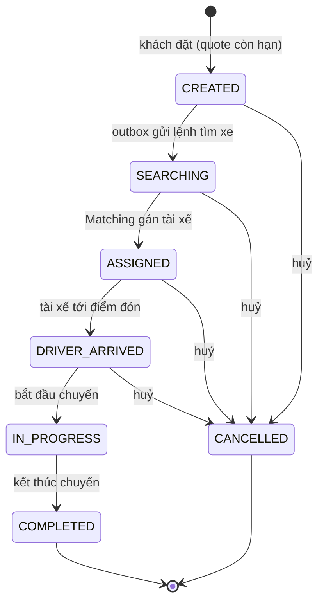

# Saga chuyến đi

| Thuộc tính | Giá trị |
| --- | --- |
| Service | Trip, Matching, Driver, Realtime |
| Rà soát | 2026-11-16 |
| Quy ước | [Format và số liệu](quy-uoc-tai-lieu.md) |

Một chuyến đi chạm tới bốn service, mỗi service có database riêng, nên không có transaction chung. Tài liệu này mô tả luồng chuyến đi như một **saga kiểu choreography**: không có bộ điều phối trung tâm, mỗi service tự làm bước của mình khi nhận lệnh hoặc event, và mỗi bước có thể hỏng đều có hành động bù trừ (compensating transaction). Đây là đề xuất D4 trong [đề xuất cải tiến hiệu năng](de-xuat-cai-tien-hieu-nang.md#54-nhóm-d-chịu-lỗi-và-vận-hành). Mô tả theo code trên nhánh `perf/adr-0008-trip-outbox`.

## 1. Vì sao là choreography

- Saga ngắn: một chuyến chỉ có vài bước, nên [kiến trúc mục tiêu](kien-truc-muc-tieu.md) đã loại công cụ điều phối như Temporal.
- Trip là chủ của trạng thái chuyến; Matching là chủ của việc tìm xe và giữ tài xế (reservation). Không service nào cần biết toàn bộ luồng.
- Mọi lệnh và event giữa service đi qua **outbox** ghi cùng transaction với thay đổi dữ liệu (Trip `outbox_deliveries`, Matching `matching_outbox`), nên không mất bước khi service đích tạm hỏng. Bên nhận **idempotent** theo `commandId`/`eventId` (bảng receipt), nên gửi lại không gây tác dụng lặp.

## 2. Trạng thái chuyến (Trip)

Nguồn: `service/trip-service/src/domain/state-machine.ts`. Không có cạnh nào ngoài các cạnh trên; mọi chuyển trạng thái kiểm tra `version` (optimistic lock) và ghi lịch sử.

Phía Matching, mỗi chuyến có một search: `SEARCHING` → `ASSIGNMENT_PENDING` (tài xế đã nhận, đang báo Trip) → `ASSIGNED`, hoặc kết thúc ở `CANCELLED` / `COMPLETED`. Offer của từng tài xế: `PENDING` → `ASSIGNMENT_PENDING` → `ASSIGNED`, hoặc `DECLINED`, `EXPIRED`, `REJECTED`, `REVOKED`.

## 3. Các bước, lỗi có thể xảy ra và bù trừ

| # | Bước | Service làm | Gửi đi | Lỗi có thể xảy ra | Bù trừ / cách xử lý |
| --- | --- | --- | --- | --- | --- |
| 1 | Khách đặt chuyến từ quote | Trip: tạo chuyến `CREATED`, ghi outbox lệnh `matching.search.requested` và event `trip.searching` trong một transaction | Outbox → Matching | Matching tắt hoặc chậm | Outbox gửi lại, chờ lâu dần; breaker (D1) trả lỗi ngay khi Matching hỏng hẳn. Lệnh tìm tới muộn khi chuyến đã huỷ thì outbox bỏ qua (`skipped`) |
| 2 | Nhận lệnh tìm xe | Matching: tạo search `SEARCHING` (idempotent theo `commandId`) | — | Lệnh huỷ tới trước lệnh tìm (outbox gửi từng delivery độc lập) | Lệnh huỷ lưu search ở trạng thái kết thúc; lệnh tìm tới sau thấy search đã có thì không làm gì |
| 3 | Tìm ứng viên và mời | Matching: lấy vị trí (Realtime), kiểm điều kiện (Driver), ETA (Routing); giữ tài xế bằng reservation; tạo offer `PENDING` sống 20 giây | `matching_outbox` → RabbitMQ → Realtime → app tài xế | Realtime/Driver/Routing lỗi hoặc bận | Job thử lại (A7, ngân sách D1); chưa giữ tài xế nào khi bước tìm lỗi |
| 4 | Tài xế không trả lời / từ chối | Matching: offer `EXPIRED` / `DECLINED` | Event offer cập nhật | — | **Bù trừ:** nhả reservation, search về `SEARCHING`, mời tài xế kế tiếp (không mời lại người đã thử) |
| 5 | Tài xế nhận | Matching: offer và search `ASSIGNMENT_PENDING`, giữ reservation | Gọi Trip `assignment` (HTTP) | Trip tắt, timeout, mạng lỗi | Giữ reservation, job thử lại với cùng `eventId` (Priority Queue xử lý job này trước). Sau lỗi, Matching đọc lại trạng thái Trip để đối soát |
| 6 | Trip nhận gán | Trip: `SEARCHING` → `ASSIGNED`, ghi event `trip.assigned` | Outbox → Gateway, notification | Chuyến đã huỷ, đã gán người khác, tài xế đang có chuyến khác (409) | **Bù trừ:** Matching đánh dấu offer `REJECTED`, nhả reservation, search về `SEARCHING`, tìm tiếp. Nếu đọc lại thấy chuyến đã `ASSIGNED` cho chính tài xế này (lần gọi trước thật ra đã thành công) thì xác nhận offer `ASSIGNED` |
| 7 | Khách hoặc tài xế huỷ | Trip: → `CANCELLED`, ghi lệnh `matching.search.cancelled` và event `trip.cancelled` | Outbox → Matching, Gateway, notification | Huỷ trong lúc offer đang chờ hoặc đã gán | **Bù trừ:** Matching thu hồi offer (`REVOKED`), nhả reservation, báo app tài xế qua Realtime. Tài xế nhận được chuyến khác |
| 8 | Hoàn thành | Trip: `IN_PROGRESS` → `COMPLETED`, ghi event `trip.completed` | Outbox → Matching, Gateway, notification | Matching tạm hỏng | Outbox gửi lại; Matching đóng search và nhả reservation khi nhận được |

Cùng một quy tắc cho mọi bước: **không bước nào sửa dữ liệu của service khác**. Bù trừ luôn là một bước mới trong service sở hữu dữ liệu đó (thu hồi offer, nhả reservation, chuyển trạng thái chuyến), được kích hoạt bằng lệnh hoặc event đã ghi bền.

## 4. Những chỗ chưa có bù trừ

| Chỗ thiếu | Hậu quả | Kích thước | Hướng xử lý |
| --- | --- | --- | --- |
| ~~Không có hạn chót tìm xe~~ **Đã làm 2026-11-22** ([ADR-0004](adr/0004-gioi-han-thoi-gian-tim-xe.md)) | Trước đây chuyến không có tài xế ở `SEARCHING` mãi | — | Matching hết hạn (mặc định 3 phút) và không còn offer chờ thì gọi Trip `no-driver-found`; Trip huỷ với actor SYSTEM, lý do `NO_DRIVER_FOUND`, rồi bù trừ như mọi lần huỷ. Offer đang chờ lúc hết hạn vẫn chạy hết 20 giây |
| Delivery outbox bị `blocked` (đích trả 4xx: sai token, sai contract) | Bước đó dừng hẳn; ví dụ lệnh huỷ không tới Matching thì tài xế vẫn bị giữ | Vừa | Đang xử lý tay: sửa nguyên nhân rồi `outbox:requeue`. Nên có cảnh báo trên số delivery `blocked` (metric đã có từ B6) |
| Huỷ sau khi đã giữ tiền | Chưa có thanh toán thật | Lớn, thuộc Phase 2 | [ADR-0005](adr/0005-payment-so-cai-kep-tcc.md): Try-Confirm-Cancel, huỷ thì nhả tiền |
| Tài xế huỷ chuyến đã nhận | Chuyến bị huỷ hẳn, khách phải đặt lại | Quyết định nghiệp vụ, không phải lỗi | Nếu muốn tự tìm tài xế khác: thêm cạnh `ASSIGNED → SEARCHING` ở Trip và lệnh tìm lại |

Khi rà soát để viết tài liệu này không thấy bước nào thiếu bù trừ mà sửa được bằng một thay đổi nhỏ; các chỗ trên đều cần quyết định thiết kế hoặc thay đổi nhiều service.

## 5. Kiểm chứng

| Hành vi | Test |
| --- | --- |
| Gửi lại quyết định, hai lần từ chối tranh nhau, mất phản hồi khi gọi Trip, chuyến kết thúc giữa lúc gán | `service/matching-service/test/integration/decisions.test.ts` |
| Hai chuyến không giữ cùng một tài xế; offer hết hạn không mời lại | `service/matching-service/test/integration/match.test.ts` |
| Lỗi tạm thời giữ delivery chờ gửi lại; chuyến đã huỷ thì bỏ lệnh tìm muộn; delivery `blocked` được requeue | `service/trip-service/test/integration/outbox.test.ts` |
| Worker khởi động lại tiếp tục các delivery đã ghi | `service/trip-service/test/integration/restart.test.ts` |
| Một chuyến hoàn thành và một chuyến huỷ qua Gateway thật | `deploy/smoke.cjs` |
